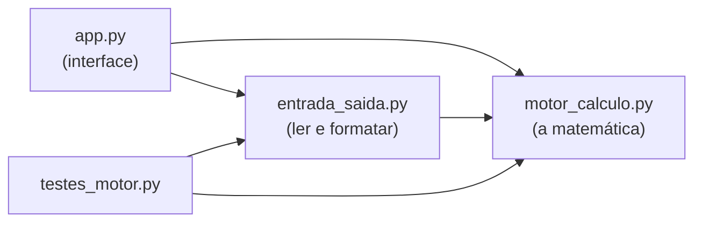
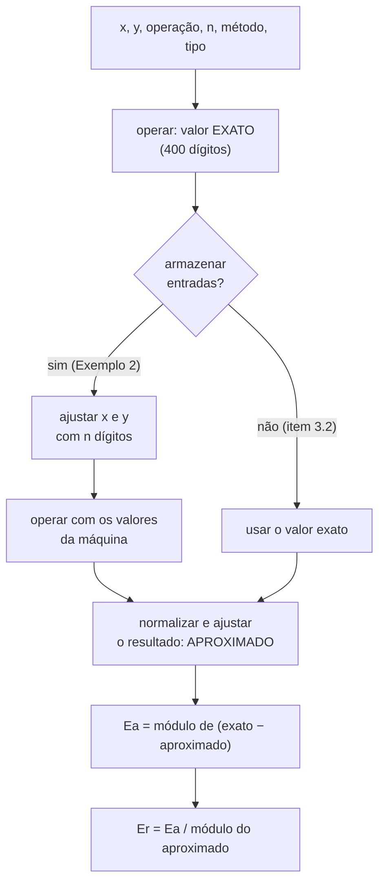

# CalcNumPy

Projeto da **Unidade 1 (Erros)** — Cálculo Numérico, Univasf, 2026.2.

O programa simula uma **máquina hipotética que só guarda `n` dígitos** e mostra, na prática, como os erros de **truncamento** e de **arredondamento** surgem, como se **acumulam** em contas sequenciais e como a **subtração de números muito próximos** (cancelamento subtrativo) destrói dígitos significativos.

> **Como usar este README:** as seções 1 a 3 explicam o repositório; a **seção 4 é o material de estudo do motor de cálculo** (o que será apresentado); a **seção 7 é o roteiro da apresentação para 3 pessoas**; a **seção 8 é um plano de estudo para a véspera**.

---

## 1. Estrutura do repositório

| Arquivo | O que tem | Entra na apresentação? |
|---|---|---|
| `motor_calculo.py` | **A matemática**: normalização, truncamento, arredondamento, operação exata, erros Ea/Er, operação simples e sequencial, cancelamento subtrativo. Não usa Streamlit. | **SIM — é o foco** |
| `entrada_saida.py` | Ler o que o usuário digita (vírgula, validação) e escrever números de forma limpa (`0.00004`, `0.1000 × 10⁻³`). | Só uma menção |
| `app.py` | A interface (Streamlit): abas, botões, tabelas. **Nenhuma conta é feita aqui.** | Não (só usar para demonstrar) |
| `testes_motor.py` | Testes automáticos: exemplos do PDF + casos de borda + comparação com implementação independente. | Sim, como validação |
| `requirements.txt` | Contém apenas `streamlit`. | Não |
| `README.md` | Este arquivo. | — |

Dependência entre os arquivos (setas = "importa de"):



O `motor_calculo.py` **não depende de nada** do resto: pode ser usado no terminal, em outro programa ou testado sozinho.

---

## 2. Como executar

```bash
pip install -r requirements.txt     # só o streamlit (o pandas vem junto)
streamlit run app.py                # abre o site (no Codespaces, abre a aba da porta 8501)
python testes_motor.py              # roda os testes do motor no terminal
```

> Os quatro arquivos `.py` precisam estar **na mesma pasta** (raiz do repositório).

### Publicação (Streamlit Community Cloud)

O site é publicado direto deste repositório, com **`app.py` como arquivo principal**. A cada `git push` na branch publicada, o Streamlit Cloud atualiza o site sozinho, **mantendo a mesma URL** (e o mesmo QR code). Se a página parecer desatualizada: *Manage app → Reboot app*.

---

## 3. O que o enunciado pede e onde está no código

| Enunciado | Onde está |
|---|---|
| 3.1 Entradas: x, y, operação, n, método | `simular_operacao(x, y, op, n, metodo, tipo, armazenar_entradas)` |
| 3.2 Operação aritmética exata | `operar()` (400 dígitos) |
| 3.2 Normalizar para notação científica (`123.45 → 0.12345×10³`) | `normalizar()` e `entrada_saida.notacao_normalizada()` |
| 3.2 Aplicar truncamento/arredondamento para `n` dígitos | `ajustar_precisao()` |
| 3.3 Valor exato, valor aproximado | campos `exato` e `aprox` de `simular_operacao()` |
| 3.3 Erro absoluto `Ea = \|exato − aprox\|` | `erro_absoluto()` |
| 3.3 Erro relativo `Er = Ea / \|aprox\|` | `erro_relativo()` |
| Exemplo 1 (soma) | demonstração: `simular_operacao(..., "+", ...)` |
| Exemplo 2 (cancelamento subtrativo) | `simular_operacao(..., "-", ..., armazenar_entradas=True)` + `digitos_perdidos_por_cancelamento()` |
| Exemplo 3 (somar 0.56786 dez vezes) | `simular_operacao_sequencial()` |
| Instrução 4: novas entradas, clareza, novo cálculo ou sair | `app.py` (calculadora livre, botões *Novo cálculo* e *Sair*, histórico) |
| Entrega: código comentado no GitHub | todos os arquivos, com docstrings e comentários |

---

## 4. Como o motor de cálculo funciona (material de estudo)

### 4.1 A máquina hipotética

Imagine uma calculadora que só guarda **`n` dígitos**. Tudo que não couber é descartado de um de dois jeitos:

* **Truncamento** — corta os dígitos que sobram.
* **Arredondamento** — olha o primeiro dígito que sobra: se for **5 ou mais**, soma 1 no último dígito guardado (*round half up*).

A diferença entre o valor exato e o que a máquina guarda é o **erro**.

### 4.2 Normalização — `normalizar()`

Todo número pode ser escrito como

> **valor = sinal × mantissa × 10^expoente**, com **0,1 ≤ mantissa < 1**

| Número | Forma normalizada |
|---|---|
| 123.45 | 0.12345 × 10³ |
| 0.00004 | 0.4 × 10⁻⁴ |
| 0.7655 | 0.7655 × 10⁰ |

**Por que normalizar?** Para definir "dígitos significativos" independentemente da escala: 123.45 e 0.0012345 têm os mesmos 5 dígitos significativos (`12345`). A normalização "alinha" todos os números para que "guardar n dígitos" signifique sempre "guardar os `n` primeiros dígitos da mantissa".

**Como o código acha o expoente:** o `Decimal` informa `adjusted()`, a posição do primeiro dígito significativo (123.45 → 2; 0.00004 → −5). O expoente da forma `0.d₁d₂…` é `adjusted() + 1`. A mantissa sai **deslocando a vírgula** (`scaleb`), que é uma operação **exata**.

### 4.3 Ajuste de precisão — `ajustar_precisao()` (o coração do trabalho)

Algoritmo em 5 passos. Exemplo: **0.66666 com n = 4**

| Passo | O que faz | Resultado |
|---|---|---|
| 1 | Normaliza | 0.66666 = 0.66666 × 10⁰ (mantissa 0.66666, expoente 0) |
| 2 | Desloca `n` casas da mantissa | 0.66666 → **6666.6** |
| 3 | Aplica o método na parte fracionária | truncamento: **6666** · arredondamento: 6666.6 + 0.5 = 6667.1 → **6667** |
| 4 | Volta as `n` casas | 0.6666 · 0.6667 |
| 5 | Desnormaliza (× 10^expoente) e devolve o sinal | 0.6666 · 0.6667 |

Outro exemplo, com expoente: **123.45 com n = 4** → mantissa 0.12345, expoente 3 → desloca: 1234.5 → truncamento 1234 → **123.4**; arredondamento 1234.5 + 0.5 = 1235.0 → 1235 → **123.5**.

Pontos importantes:

* **Arredondamento = somar 0,5 e truncar.** É a definição clássica "5 ou mais sobe". O `round()` do Python **não serve**: ele usa *arredondamento do banqueiro* (`round(2.5) = 2`, `round(0.5) = 0`).
* **O sinal é tratado à parte:** o método age sobre o valor absoluto e o sinal volta no fim. Logo, o truncamento sempre aproxima de **zero** (−0.76549 → −0.7654).
* **Dois jeitos de contar `n`** (parâmetro `tipo`):
  * `"significativos"`: `n` dígitos da mantissa (item 3.2 do enunciado).
  * `"decimais"`: `n` casas depois do ponto — mesmo algoritmo, **sem normalizar** (1.13572 → 11357.2 → 11357 → 1.1357).
  
  Os dois existem porque **o próprio enunciado usa os dois** (ver 4.7).

**Limites teóricos do erro relativo (em relação ao valor exato)** para `n` dígitos significativos em base 10:

| Método | Erro relativo máximo |
|---|---|
| Truncamento | < 10^(1−n) |
| Arredondamento | ≤ ½ · 10^(1−n) |

Com n = 4: 0,1% e 0,05%. O arredondamento tem **metade** do erro máximo do truncamento.

### 4.4 Operação exata e erros — `operar()`, `erro_absoluto()`, `erro_relativo()`

* `operar()` faz a conta com **400 dígitos** de precisão: é o "valor exato" (precisão máxima da linguagem, item 3.3). Com as entradas limitadas (até 50 dígitos, expoente até ±100), somas, subtrações e multiplicações saem **exatas**; a divisão (ex.: 1/3) usa 400 dígitos.
* `Ea = |exato − aproximado|`
* `Er = Ea / |aproximado|` — **definição do enunciado** (o usual na literatura é dividir pelo exato; no Exemplo 2 isso daria 150% em vez de 60%).
* **Caso especial:** se o aproximado é 0, o `Er` é **indefinido** (o enunciado só o define "quando o valor aproximado for diferente de zero"); se além disso `Ea = 0`, não há erro e `Er = 0`.

### 4.5 Uma operação completa — `simular_operacao()`



### 4.6 Dois modelos de máquina (parâmetro `armazenar_entradas`)

O PDF usa dois modelos e o código suporta os dois:

| Modelo | Quem usa | O que faz |
|---|---|---|
| `False` — **só o resultado** | Item 3.2 e Exemplo 1 | Opera com os valores exatos e ajusta **apenas o resultado**. |
| `True` — **máquina hipotética** | Exemplo 2 | Guarda `x` e `y` com `n` dígitos **antes** de operar e ajusta de novo o resultado. |

Podem dar valores diferentes por causa do **ajuste duplo**. Exemplo: `0.12345 + 0.12345`, n = 4, arredondamento → `0.2469` (só resultado) × `0.247` (entradas guardadas: 0.12345 vira 0.1235 antes da soma).

### 4.7 Propagação de erros em sequência — `simular_operacao_sequencial()` (Exemplo 3)

Repete uma operação várias vezes **ajustando a cada passo**. O erro de um passo entra na conta do próximo e **se acumula**.

Em cada passo guarda: `anterior` (acumulado da máquina), `bruto` (anterior op termo, antes do ajuste), `apos` (bruto ajustado = novo acumulado), `exato_parcial` (mesma conta sem ajuste algum) e `erro` (|exato_parcial − apos|).

**Atenção — o PDF é ambíguo aqui.** O item 3.2 define `n` como dígitos significativos, mas os passos do Exemplo 3 (`1.1357`, `1.7035`, `2.2713`) cortam em **4 casas decimais** (1.1357 tem 5 dígitos significativos). Por isso o programa mostra as **duas versões**:

| Versão | Passos | Final | Ea | Er |
|---|---|---|---|---|
| **4 casas decimais** (como o PDF) | 1.1357 · 1.7035 · 2.2713 · 2.8391 · 3.4069 · 3.9747 · 4.5425 · 5.1103 · **5.6781** | 5.6781 | 0.0005 | ≈ 0,0088% |
| **4 dígitos significativos** (item 3.2) | 1.135 · 1.702 · 2.269 · 2.836 · 3.403 · 3.97 · 4.537 · 5.104 · **5.671** | 5.671 | 0.0076 | ≈ 0,134% |

Valor exato: `10 × 0.56786 = 5.6786`. Note que a 1ª soma é `0.56786 + 0.56786 = 1.13572` (a parcela entra "cheia") e que 10 termos são **9 somas**.

Com arredondamento (4 casas): final **5.6789**, Ea = **0.0003** — erro menor que o do truncamento (0.0005), mas **não se cancela**: como o 5º decimal da parcela é sempre 6, o arredondamento erra para cima em todos os passos.

### 4.8 Cancelamento subtrativo — Exemplo 2 e `digitos_perdidos_por_cancelamento()`

`x = 0.76545`, `y = 0.76541`, n = 4. Valor exato: `0.00004`.

| | x na máquina | y na máquina | x − y | Ea | Er |
|---|---|---|---|---|---|
| **Arredondamento** | 0.7655 | 0.7654 | 0.0001 | 0.00006 | **0.6 (60%)** |
| **Truncamento** | 0.7654 | 0.7654 | **0** | 0.00004 | **indefinido** |

Os primeiros dígitos (iguais) se anulam e sobram só os últimos — justamente os que o armazenamento com `n` dígitos distorce. Com arredondamento o erro relativo é de 60%; com truncamento a subtração **fica nula**.

O código detecta o fenômeno: em soma/subtração, se `|exato|` for pelo menos 100 vezes menor que o maior operando, informa quantas **ordens de grandeza** foram perdidas (aqui, 4).

### 4.9 Por que `Decimal` e não `float`?

O enunciado pede números em ponto flutuante como **entrada** (o usuário digita `0.76545`, `0,76545`, `1e-5`…). Isso é atendido. O que mudou é a **representação interna**:

* A máquina hipotética do enunciado é **decimal** (0.7655 × 10⁰).
* O `float` do Python é **binário** e não guarda 0.7655 nem 28.4 exatamente:

```python
>>> from decimal import Decimal
>>> Decimal(28.4)
Decimal('28.39999999999999857891452847979962825775146484375')
>>> Decimal(0.7655)
Decimal('0.76549999999999995825561427409411408007144927978515625')
```

Com `float`, truncar `28.4` com n = 4 dava **28.39** — um erro que não é da "máquina hipotética", é do Python. Com `Decimal` os dígitos digitados são guardados **exatamente** e só aparece o erro que **nós** queremos simular. O "valor exato" também é `Decimal` com 400 dígitos (precisão máxima da linguagem).

### 4.10 Robustez e limites

* Entrada: aceita ponto **ou** vírgula, notação científica; rejeita vazio, texto, `NaN`, `Infinity`, espaço no meio, mais de um separador, mais de 50 dígitos, expoente fora de ±100.
* `n` entre 1 e 30.
* Divisão por zero (inclusive quando `Y` **vira zero** ao ser guardado na máquina) gera mensagem amigável, sem travar.
* Todas as contas usam um **contexto explícito** de 400 dígitos. Operações "soltas" como `abs(d)` ou `d.normalize()` arredondariam para 28 dígitos (padrão do Python), então o código usa `copy_abs()` e `normalize(CTX_EXATO)`.

### 4.11 Mini-glossário do `Decimal` (para ler o código sem tropeçar)

| Método | O que faz | Onde aparece |
|---|---|---|
| `Decimal("0.66666")` | Número decimal exato, lido do texto | em todo lugar |
| `d.adjusted()` | Posição do 1º dígito significativo (123.45 → 2) | `normalizar` |
| `d.scaleb(k)` | Multiplica por 10^k deslocando a vírgula, **sem erro** | `normalizar`, `ajustar_precisao` |
| `d.to_integral_value(ROUND_DOWN)` | Joga fora a parte fracionária (corta) | `_inteiro_pelo_metodo` |
| `d.copy_abs()` / `copy_negate()` | Valor absoluto / troca de sinal, sem arredondar | erros, sinal |
| `CTX_EXATO.add/subtract/multiply/divide` | Contas com 400 dígitos | `operar` |

---

## 5. Resultados dos exemplos do PDF (conferidos por `testes_motor.py`)

**Exemplo 1** — `0.12345 + 0.54321`, n = 4, só o resultado (valor exato `0.66666`):

| Método | Aproximado | Ea | Er |
|---|---|---|---|
| Truncamento | 0.6666 | 0.00006 | ≈ 0,009001% |
| Arredondamento | 0.6667 | 0.00004 | ≈ 0,006% |

**Exemplo 2** e **Exemplo 3**: tabelas nas seções 4.8 e 4.7.

---

## 6. Como validamos o motor (`testes_motor.py`)

1. **Exemplos do PDF:** reproduz os três exemplos e confere cada valor (aproximados, Ea, Er).
2. **Casos em que o `float` erraria:** 28.4, 273.9, 789.05, 1.005, 1e-20, 999.9999999999999…
3. **Comparação com implementação independente:** 20 000 números aleatórios (positivos e negativos, com e sem expoente, `n` de 1 a 12, truncamento e arredondamento, os dois tipos de ajuste). A referência foi escrita com **frações exatas** (`Fraction`) e sem usar nada do motor. Resultado: **0 divergências**.
4. **Casos especiais:** divisão por zero, `Er` indefinido, `0.5 − 0.5`, entradas inválidas.

Para rodar: `python testes_motor.py` → termina com **"✔ Todos os testes passaram."**

---

## 7. Roteiro da apresentação (3 pessoas)

> Tempo sugerido: **~5 min por pessoa (≈ 15 min no total)**. Ajustem conforme o tempo que o professor der. A ordem segue o fluxo dos dados: **da máquina → às contas e erros → à propagação**. Cada pessoa mostra o código do **seu** trecho e usa o site só para **demonstrar** o resultado (aba *Casos de demonstração*).

### 👤 Pessoa 1 — A máquina hipotética e o ajuste de precisão  *(≈ 5 min)*
**Arquivo:** `motor_calculo.py` → `normalizar()`, `_inteiro_pelo_metodo()`, `ajustar_precisao()`.

1. **Abertura (1 min)** — *"O trabalho é um simulador de uma máquina que guarda só n dígitos. Ele mostra como truncamento e arredondamento geram erro, como o erro se acumula e o que acontece quando subtraímos números quase iguais."*
2. **Normalização (1 min)** — Mostrar `normalizar()`. *"Todo número vira ±0.d₁d₂… × 10ᵉ. Assim 'guardar n dígitos' significa a mesma coisa para 123.45 e para 0.00004. O expoente vem da posição do primeiro dígito, e a mantissa sai deslocando a vírgula, sem divisão e sem log10, então não há erro."*
3. **Ajuste de precisão (2 min)** — Mostrar `ajustar_precisao()` e fazer na lousa/tela o exemplo **0.66666, n = 4**: *"desloca n casas: 6666.6. Truncamento descarta a parte fracionária: 6666. Arredondamento soma 0,5 e descarta: 6667. Volta as casas: 0.6666 ou 0.6667."* Citar: arredondamento = *somar 0,5 e truncar*; sinal tratado à parte (truncamento aproxima de zero).
4. **Por que Decimal (1 min)** — *"A máquina do enunciado é decimal; o float é binário e não guarda 0.7655 nem 28.4. Com float, truncar 28.4 com n = 4 dava 28.39. Com Decimal só aparece o erro que queremos simular."* (mostrar `Decimal(28.4)` no terminal, seção 4.9). Reforçar: **a entrada continua sendo número em ponto flutuante**, como pede o item 3.1.
5. **Demo:** aba *Casos de demonstração* → **Exemplo 1**: truncamento 0.6666 × arredondamento 0.6667. 
6. **Passagem:** *"Agora o [Pessoa 2] mostra como esse ajuste entra nas operações e como medimos o erro."*

### 👤 Pessoa 2 — Operações, erros e cancelamento subtrativo  *(≈ 5 min)*
**Arquivo:** `motor_calculo.py` → `operar()`, `erro_absoluto()`, `erro_relativo()`, `simular_operacao()`, `digitos_perdidos_por_cancelamento()`.

1. **Valor exato (45 s)** — *"`operar()` faz a conta com 400 dígitos: é o 'valor exato' do item 3.3, a precisão máxima da linguagem."*
2. **Erros (1 min 15 s)** — *"Erro absoluto é o módulo da diferença entre exato e aproximado. O erro relativo, seguindo o enunciado, divide pelo aproximado. Se o aproximado for zero o erro relativo é indefinido, e o código trata isso."* (curiosidade: dividindo pelo exato, o Exemplo 2 daria 150%).
3. **`simular_operacao` (1 min 30 s)** — Mostrar o fluxograma da seção 4.5. *"Calcula o exato, opcionalmente guarda x e y com n dígitos, opera, ajusta o resultado e calcula Ea e Er. Há dois modelos porque o PDF usa os dois: o item 3.2 ajusta só o resultado, e o Exemplo 2 guarda as entradas antes. Eles podem diferir — 0.12345 + 0.12345 dá 0.2469 num e 0.247 no outro — por causa do ajuste duplo."*
4. **Exemplo 2 ao vivo (1 min 30 s)** — Aba *Casos de demonstração* → **Exemplo 2**. *"Exato: 0.00004. Com arredondamento x vira 0.7655 e y vira 0.7654, a diferença dá 0.0001: erro relativo de 60%. Com truncamento os dois viram 0.7654 e a subtração dá zero: perdemos todos os dígitos significativos. É o cancelamento subtrativo; o código detecta e avisa quantas ordens de grandeza foram perdidas."*
5. **Passagem:** *"E se repetirmos operações em sequência? O [Pessoa 3] mostra."*

### 👤 Pessoa 3 — Propagação em sequência, decisões e validação  *(≈ 5 min)*
**Arquivo:** `motor_calculo.py` → `simular_operacao_sequencial()`; `testes_motor.py`.

1. **Sequência (1 min 30 s)** — *"A cada passo ajustamos o resultado; o erro do passo entra na conta do seguinte e vai se acumulando. Guardamos, por passo, o acumulado da máquina e o mesmo cálculo sem ajuste, e o erro entre os dois."*
2. **Exemplo 3 ao vivo (1 min 30 s)** — Aba *Casos de demonstração* → **Exemplo 3** → mostrar a tabela e o gráfico. *"Somar 0.56786 dez vezes: o exato é 5.6786. Com truncamento em 4 casas decimais, como nos passos do PDF (1.1357, 1.7035, 2.2713…), o resultado final é 5.6781."*
3. **A ambiguidade do PDF (1 min)** — *"O PDF define n como dígitos significativos, mas os passos do Exemplo 3 cortam em casas decimais. Por isso o programa mostra as duas versões: 5.6781 em 4 casas e 5.671 em 4 dígitos significativos. Na análise crítica, isso mostra que a escolha da convenção muda o erro."* Comparar truncar × arredondar: truncamento erra sempre para baixo (limite < 10^(1−n)); arredondamento tem metade do limite (≤ ½·10^(1−n)), mas aqui também acumula, porque o 5º decimal é sempre 6.
4. **Validação e robustez (45 s)** — *"Para garantir que está certo, o `testes_motor.py` confere os exemplos do PDF e compara o motor com uma implementação independente, escrita com frações exatas, em 20 mil números aleatórios: zero divergências. A entrada aceita vírgula, rejeita lixo e trata divisão por zero."* (mostrar `python testes_motor.py` terminando em **"Todos os testes passaram"**).
5. **Conclusão (15 s)** — *"Truncamento e arredondamento são fontes inevitáveis de erro; o erro se propaga e se acumula; subtrair números próximos é perigoso; e usar a representação certa (decimal) evita misturar o erro do Python com o erro que queremos estudar."*

### ✅ Checklist antes de apresentar
* Abrir a URL do site **10–15 min antes**: o Streamlit Cloud coloca apps parados em espera. Se aparecer o botão para "acordar" o app, clicar e esperar carregar.
* **Testar o QR code** com o celular (e com os dados móveis, caso o Wi-Fi da sala falhe).
* Deixar o **Codespace aberto** com `motor_calculo.py` e um terminal pronto.
* Zoom do navegador/editor em ~125% para a sala ler.
* Ensaiar a passagem entre as pessoas.

### 🛟 Plano B (se o site não abrir)
1. No Codespaces: `streamlit run app.py` e abrir a porta 8501 (mostra o mesmo site).
2. Sem site nenhum: `python testes_motor.py` mostra no terminal os três exemplos do PDF com todos os valores.
3. Ter **prints** das telas dos Exemplos 1, 2 e 3 salvos antes.

---

## 8. Perguntas prováveis do professor (e respostas curtas)

| # | Pergunta | Resposta |
|---|---|---|
| 1 | **Por que `Decimal` e não `float`?** (quem responde: P1) | A máquina do enunciado é decimal, o `float` é binário e não guarda 0.7655/28.4 exatamente; isso introduz um erro que não é o que queremos simular (28.4 truncado dava 28.39). |
| 2 | **O enunciado pede ponto flutuante. Vocês não usaram?** (P1) | A **entrada** é em ponto flutuante (o usuário digita `0.76545`, `1e-5`…). Só a representação interna é decimal, justamente para simular a máquina em base 10 sem misturar o erro binário do Python. |
| 3 | **Por que normalizar?** (P1) | Para definir "dígitos significativos" independentemente da escala e aplicar o corte sempre nos `n` primeiros dígitos da mantissa. |
| 4 | **Como o arredondamento é feito? Usa `round()`?** (P1) | Não. O `round()` do Python é arredondamento do banqueiro (`round(2.5) = 2`). Fazemos *somar 0,5 e truncar* na mantissa deslocada, que é "5 ou mais sobe". |
| 5 | **Por que o Er divide pelo aproximado?** (P2) | É a definição dada no enunciado. (No Exemplo 2, dividindo pelo exato daria 150% em vez de 60%.) |
| 6 | **O que acontece se o aproximado for 0?** (P2) | O Er é indefinido (o enunciado só o define para aproximado ≠ 0) e o programa avisa; se Ea também for 0, Er = 0. |
| 7 | **Por que dois modelos (armazenar entradas ou só resultado)?** (P2) | Porque o PDF usa os dois: item 3.2 ajusta só o resultado; o Exemplo 2 guarda x e y antes. Eles podem diferir por causa do ajuste duplo (0.2469 × 0.247). |
| 8 | **O que é cancelamento subtrativo?** (P2) | Subtrair números quase iguais: os primeiros dígitos se anulam e sobram só os últimos, que são os mais afetados pelo armazenamento. No Exemplo 2: erro de 60% (arredondamento) ou resultado zero (truncamento). |
| 9 | **Qual a diferença de erro entre truncamento e arredondamento?** (P3) | Erro relativo máximo < 10^(1−n) no truncamento e ≤ ½·10^(1−n) no arredondamento. O truncamento erra sempre na mesma direção (para zero). |
| 10 | **Por que dois tipos de ajuste (dígitos significativos × casas decimais)?** (P3) | O item 3.2 fala em dígitos significativos, mas os passos do Exemplo 3 cortam em casas decimais (1.1357). Suportamos os dois e mostramos as duas versões: 5.6781 × 5.671. |
| 11 | **Como sabem que está certo?** (P3) | `testes_motor.py`: exemplos do PDF + comparação com implementação independente (frações exatas) em 20 mil números aleatórios, 0 divergências. |
| 12 | **Por que 400 dígitos?** (P3) | Com entradas de até 50 dígitos e expoente ±100, somas/subtrações/multiplicações cabem exatas em 400 dígitos; a divisão (ex.: 1/3) usa 400 dígitos, na prática o "exato". |
| 13 | **E números negativos?** (P1) | O sinal é separado: o método age no valor absoluto e o sinal volta no fim. Truncar −0.76549 dá −0.7654; arredondar −0.76545 dá −0.7655. |
| 14 | **Limitações?** (qualquer um) | `n` de 1 a 30; entradas até 50 dígitos e expoente ±100; o modelo é decimal, não o padrão IEEE 754 binário. |

---

## 9. Roteiro de estudo (≈ 1h30 na véspera)

1. **(10 min) Rodar e ler a saída:** `python testes_motor.py` — a saída mostra os três exemplos do PDF e tudo que o código verifica.
2. **(20 min) `ajustar_precisao`:** ler a docstring de `motor_calculo.py`, depois `normalizar`, `_inteiro_pelo_metodo` e `ajustar_precisao`. **Faça à mão**: 0.66666 (n = 4, os dois métodos), 123.45 (n = 4) e −0.76545 (arredondamento).
3. **(15 min) Erros e `simular_operacao`:** ler `operar`, `erro_absoluto`, `erro_relativo`, `simular_operacao`. **Faça à mão** o Exemplo 2 inteiro (x e y, subtração, Ea, Er).
4. **(15 min) Sequência:** ler `simular_operacao_sequencial`. **Faça à mão** os 3 primeiros passos do Exemplo 3 (1.13572 → 1.1357; 1.70356 → 1.7035; 2.27136 → 2.2713).
5. **(10 min) Explorar no terminal** (`python` na pasta do projeto):
   ```python
   from decimal import Decimal as D
   from motor_calculo import normalizar, ajustar_precisao, simular_operacao
   from entrada_saida import formatar

   normalizar(D("123.45"))                                       # (1, Decimal('0.12345'), 3)
   formatar(ajustar_precisao(D("0.66666"), 4, "truncamento", "significativos"))    # '0.6666'
   formatar(ajustar_precisao(D("0.66666"), 4, "arredondamento", "significativos")) # '0.6667'

   r = simular_operacao(D("0.76545"), D("0.76541"), "-", 4, "arredondamento", "significativos", True)
   print(formatar(r["aprox"]), formatar(r["ea"]), formatar(r["er"]))   # 0.0001 0.00006 0.6
   ```
6. **(20 min) Ensaio em voz alta:** cada pessoa fala o seu bloco (seção 7) com cronômetro e faz a passagem para o próximo.

> `app.py` e `entrada_saida.py` **não precisam ser estudados a fundo**: basta saber que o primeiro desenha a página e o segundo lê/escreve números.
